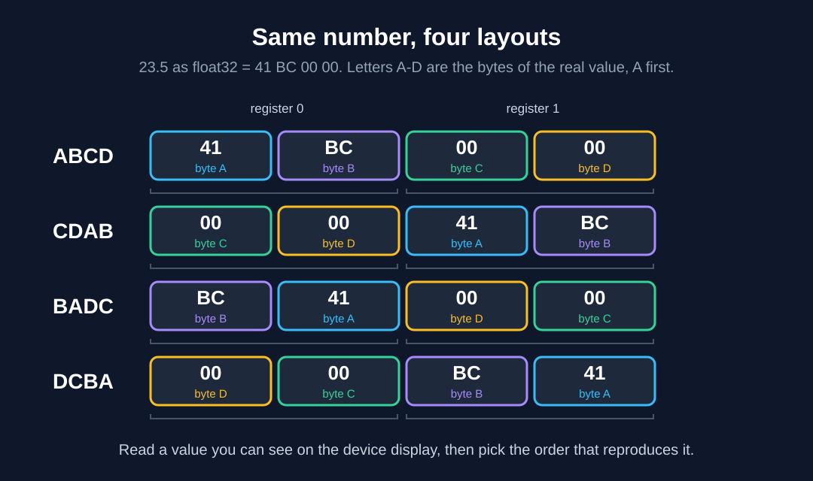

# 01 Numbers and bytes

Most "the data is wrong" problems turn out to be a number format problem. Everything here is reproduced by `examples/number_formats.py`.

## Signed and unsigned

A Modbus register is 16 bits with no sign. Whether it means a positive or a negative number depends on how you read it.

| Register | Unsigned | Signed (int16) |
|---|---|---|
| `0x0044` | 68 | 68 |
| `0xFFBC` | 65468 | -68 |

Two's complement by hand, for -68 as 8 bits: write 68 (`0100 0100`), flip every bit (`1011 1011`), add 1 (`1011 1100`). That is `0xBC`. As an unsigned byte it is 188, as a signed byte it is -68.

If a value that should never be negative shows up huge (65468, 4294967228), it is a negative number read as unsigned.

## float32

A float32 has 1 sign bit, 8 exponent bits and 23 mantissa bits. For 23.5:

```
23.5 = 10111.1 in binary = 1.01111 x 2^4
sign     0
exponent 4 + 127 (bias) = 131 = 1000 0011
mantissa 0111 1000 0000 0000 0000 000
bytes    0100 0001 1011 1100 0000 0000 0000 0000 = 41 BC 00 00
```

## Two registers make one 32-bit value

A 32-bit float or integer is split across two 16-bit registers, and devices do not agree on the order. Call the bytes of the real value A B C D, with A the most significant. For 23.5 that is `41 BC 00 00`.

| Name | Registers sent | Notes |
|---|---|---|
| ABCD | `41BC 0000` | Straight big-endian |
| CDAB | `0000 41BC` | Words swapped. Very common |
| BADC | `BC41 0000` | Bytes swapped inside each word. Rare |
| DCBA | `0000 BC41` | Fully little-endian |



The manual does not always say which one a device uses, and some manuals are wrong. The reliable way is to read a value you can see on the device display and try the four orders until one matches. The `decode` tool in [plc-simulators](https://github.com/pratik-kadam-automation/plc-simulators) does this in one command.

The same applies to 32-bit integers, not only floats.

## Counters wrap around

A free-running counter goes back to 0 after its maximum (65535 for 16-bit, 4294967295 for 32-bit). A delta calculation has to expect that:

```python
delta = (current - previous) % 2**bits
```

`counter_delta(65534, 3, 16)` gives 5, not a huge negative number. A counter that goes backwards by a small amount is different. That usually means the source restarted or a read was bad, and it should not be treated as a wrap.
