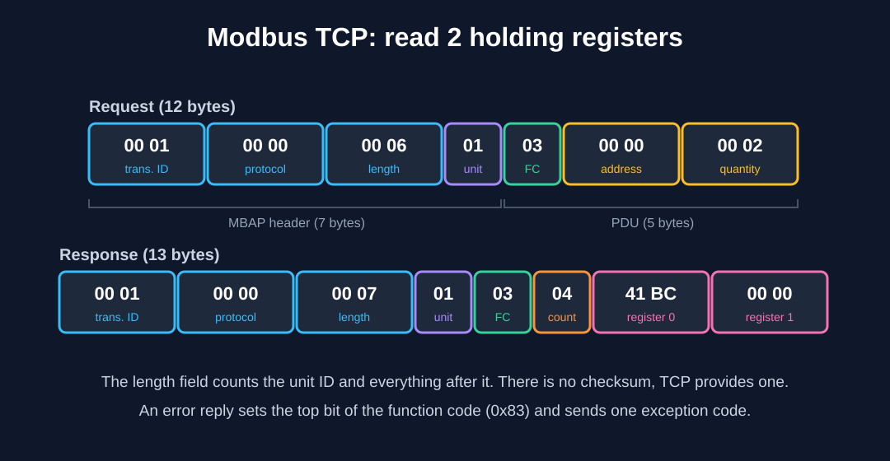

# 02 Modbus

Official spec: the "Modbus Application Protocol Specification" and "Modbus over Serial Line" on [modbus.org](https://modbus.org/specs.php). Examples below come from `examples/modbus_walkthrough.py`.

## Data model

| Space | Access | Read | Write |
|---|---|---|---|
| Coils | bit, read/write | FC 1 | FC 5, FC 15 |
| Discrete inputs | bit, read only | FC 2 | none |
| Input registers | 16-bit, read only | FC 4 | none |
| Holding registers | 16-bit, read/write | FC 3 | FC 6, FC 16 |

Many devices put the same data in both input and holding registers, and some only in one. If FC 3 gives an exception or zeros, try FC 4.

Limits per request: 125 registers for FC 3 and 4, 2000 bits for FC 1 and 2, 123 registers for FC 16.

## Addressing

On the wire the address is **0-based**. Documentation often is not:

| What the manual says | Address on the wire |
|---|---|
| 40001 (holding register, 5-digit style) | 0 |
| 400001 (6-digit style) | 0 |
| Register 1, "1-based" | 0 |
| Register 0 | 0 |

If every value is shifted by one register, the address base is wrong. This is the first thing to check.

## Modbus TCP frame



Read 2 holding registers starting at address 0, unit 1:

```
request   00 01 00 00 00 06 01 03 00 00 00 02
response  00 01 00 00 00 07 01 03 04 41 BC 00 00
```

| Bytes | Field |
|---|---|
| `00 01` | Transaction ID, echoed back so you can match replies |
| `00 00` | Protocol ID, always 0 |
| `00 06` | Length of what follows (unit ID + PDU) |
| `01` | Unit ID. Ignored by many devices, but a gateway in front of serial devices uses it to pick the device |
| `03` | Function code |
| `00 00` / `00 02` | Start address / quantity |

In the response, `04` is the byte count and `41 BC 00 00` are the two registers. There is no checksum. TCP already provides one.

## Modbus RTU frame

```
01 03 00 00 00 0A C5 CD
unit, function, address, quantity, CRC-16
```

The CRC is CRC-16 with polynomial 0xA001, sent **low byte first**. Frames are separated by silence of at least 3.5 character times, not by a length field. That is why an RTU master that pauses in the middle of a frame can break communication.

Time for one poll at 11 bits per character (start, 8 data, parity, stop), reading 2 registers (8 byte request, 9 byte reply), not counting device processing time:

| Baud | Time per poll |
|---|---|
| 9600 | about 27.5 ms |
| 19200 | about 13.7 ms |
| 115200 | about 2.3 ms |

So 40 devices on a 9600 baud line cannot all be polled once a second (40 x 27.5 ms is 1.1 s). Do this arithmetic before promising a sample rate.

## Exceptions

An error reply has the function code with the top bit set (`0x83` for a failed FC 3) and one code byte.

| Code | Meaning | Usual cause |
|---|---|---|
| 01 | Illegal function | Device does not support that FC. Try FC 4 instead of 3 |
| 02 | Illegal data address | Address outside what the device exposes, or off by one |
| 03 | Illegal data value | Quantity too large, or a bad write value |
| 04 | Server device failure | Device-side fault |

No reply at all is different from an exception. That usually means wrong IP or port, wrong baud or parity, wrong unit ID, or two devices with the same address on an RS-485 line.

## Mistakes I check for

1. Address base off by one.
2. Wrong word order on 32-bit values.
3. FC 3 versus FC 4.
4. Unit ID on a gateway.
5. Reading too many registers in one request for that device.
6. Polling faster than the device or the serial line can answer.
